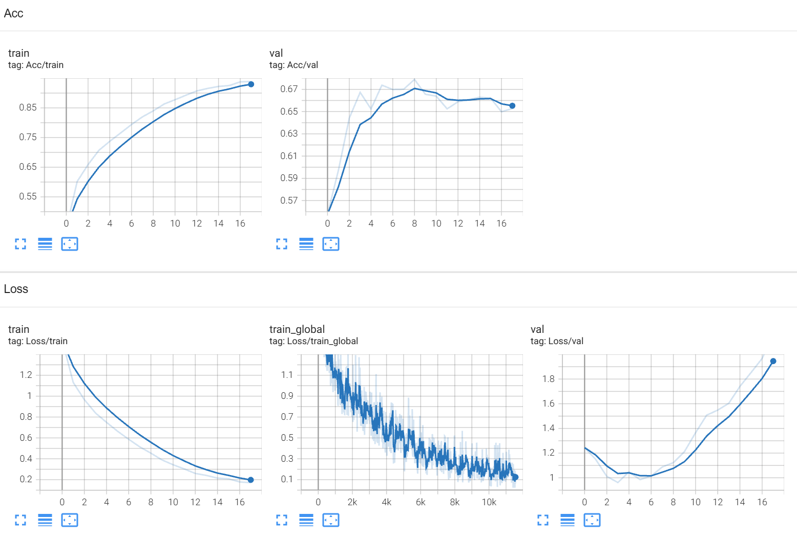

# PyTorch

## PyTorch简介

PyTorch 是一个以张量计算和自动微分为基础的深度学习框架。 它提供了构建神经网络、计算梯度、训练模型、使用 GPU 加速以及部署模型等功能。

- 易于使用： 编程风格接近 Python，方便调试和实验。
- 自动求导： 可以自动计算神经网络训练所需的梯度。
- GPU 加速： 可以将张量计算和模型运算放到 GPU 上。
- 灵活构建模型： 可以自定义网络结构、损失函数和训练流程。
- 生态丰富： 支持计算机视觉、自然语言处理、生成式 AI、分布式训练等任务

## PyTorch基础

PyTorch 最为常用的两个库是 `torch` 和 `torchvision`，此外还有 `torchaudio` 和 `torchtext`，分别用于处理不同领域的问题。下面要介绍的基础内容需要 `import torch`

### CUDA模块

CUDA（Compute Unified Device Architecture）是一种**并行计算平台**，它允许开发者利用 Nvidia GPU 的并行计算能力来加速应用程序的运行。与传统的 CPU 相比，GPU 在处理大规模并行计算任务时具有显著的优势。

`torch.cuda` 模块是 PyTorch 用于与 CUDA 相关功能交互的核心模块，支持使用 GPU 加速计算任务。因此，该模型的首要功能就是 GPU **设备管理**：

- `torch.cuda.is_available()`：返回 true/false，表示当前系统上是否有可用的 GPU。
- `torch.cuda.current_device()`：返回当前所选 GPU 设备的索引。
- `torch.cuda.device_count()`：返回系统中可用的 GPU 数量，会受到程序可见 GPU 设置的影响。
- `torch.cuda.get_device_name(index)`：返回指定设备的名称，`index` 为 GPU 号。

此外，还可以进行**内存管理**，在代码的关键部分插入以下语句，即可监控显存占用：

- `torch.cuda.memory_allocated()`：返回当前分配给张量的 GPU 显存**字节数**，张量需要移动到 CUDA device 上才可以查看。`torch.cuda.memory_allocated()/1024/1024/1024` 即可得到显存 GB 数。
- `torch.cuda.max_memory_allocated()`：同上，但是返回**到目前为止程序运行过程中分配的最大显存量**。

> 需要注意的是，如果在某个点上显存被释放了，使用该函数看到的将是释放后的显存使用情况。

在使用多卡训练、多卡推理的时候，需要设置可见设备，以下是常见的几种方法：

1. 使用 PyTorch 进行管理：`torch.cuda.set_device(0)`
2. 在脚本入口使用 os 管理： `os.environ["CUDA_VISIBLE_DEVICES"] = "0,1"`
3. 在命令行中直接设置： `CUDA_VISIBLE_DEVICES=0,1 python main.py`

### Tensor对象

Tensor（张量）是 PyTorch 的核心数据结构，与 NumPy 中的 ndarrary 十分相似，表示**多维矩阵**，区别是 Tensor 支持 GPU 上的分布式运算，且支持「**自动微分**」。

Tensor 具有三个主要属性，`dtype`、`shape`、`device`，分别表示元素的数据类型、形状参数和**所属设备**。

```python
>>> a = np.array([1, 2])
# a = array([1, 2])
# a.dtype = dtype('int32')
# a.shape = (2,)
# a.size = 2 （元素个数）
>>> t = torch.tensor(a)
# t = tensor([1, 2], dtype=torch.int32)
# t.dtype = torch.int32
# t.shape = torch.Size([2])
# t.size() = torch.Size([2])
# t.device = device(type='cpu')
>>> torch.is_tensor(a), torch.is_tensor(t)
# False True
```

在进行 Tensor 的数学运算时，与其他语言不同，**高精度数据类型不能赋值给低精度类型**，例如将 float 赋值给 int，将 non-boolen 赋值给 bool。

对于 Tensor 独有的 `device` 属性，需要通过**字符串**变量定义，可选的类型有

```python
>>> torch.device('cpu')		# CPU 上运行，无法使用 GPU 加速
# device(type='cpu')
>>> torch.device('cuda:0')	# 指定编号，在多 GPU 时指定单卡
# device(type='cuda', index=0)
>>> torch.device('cuda')	# 默认调取首个 GPU 设备
# device(type='cuda')
```

可以在创建张量时指定其所属设备，也可以在创建后使用 `to` 切换，`to` 会返回一份**新设备上的拷贝**，不会覆盖旧设备，因此通常用 `=` 主动覆盖：

```python
# 初始化时设置参数
t1 = torch.tensor([0.1, 0.2], dtype=torch.float64, device=torch.device('cuda:0'))

# 先定义，后根据实际条件切换参数
t2 = torch.tensor([1])
if torch.cuda.is_available(): t2 = t2.to('cuda')
    
# 训练时设置参数
self.device = torch.device('cuda' if torch.cuda.is_available() else 'cpu')
self.Model = self.Model.to(self.device)
```

除了三个主要属性，张量还支持一些形如 `t.func()` 的「**函数型属性**」：

- `t.item()`：对于一个**只含有一个元素**的张量（无论多少维度），返回一个**标量值**，常用于打印 Loss、sum。
- `t.cpu()`：将张量、模型**移动**到 CPU 上，用于进行普通的 Python 或 NumPy 操作，常用 `t.cpu().numpy()`。
- `t.size()`：返回张量的形状，等价于 `t.shape`。带参数时 `t.size(0)` 相当于 `t.shape[0]`。
- `t.numel()`：返回张量中**元素的个数**，某些运算不需要形状相同，只需要元素个数相同，就得先判断。
- `t.detach()`：分离出原张量的一个**拷贝**，但是 `requires_grad=False`，二者**共享内存空间**。反向传播到该张量时会停止，常用于**冻结**网络参数、**限制**梯度传播距离。

### Tensor构造

- **已有容器转化张量**

生成 Tensor 的基本函数是 `torch.tensor()`，其参数可以是 list 、tuple、**另一个 Tensor 甚至 ndarray**

```python
"""
    data: 	传入原数组，深拷贝数据，且创建的 Tensor 没有微分历史
    dtype: 	指定数据类型，默认根据原数组推断
    device: 创建 Tensor 的设备，如果 data 也是 Tensor 则跟随，否则会默认在 CPU 上
    requires_grad: 是否支持自动求导，默认不支持
    pin_memory: 是否存于锁页内存，加载数据时可以更快地从 CPU 拷贝到 GPU，但可能导致内存爆炸
"""
torch.tensor(data, *, dtype=None, device=None, requires_grad=False, pin_memory=False)

torch.tensor(1)			# 创建一个零维张量（不等同于标量）
torch.tensor([0, 1])	# 创建一个一维张量
torch.tensor([[0.1, 1.2], [2.2, 3.1]])	# 创建一个二维张量
torch.tensor([[1, 2]], dtype=torch.float64, device=torch.device('cuda:0'))	# 设置参数
torch.tensor([0.5, 1.5], device=torch.device('cuda:0'), requires_grad=True)	# 设置参数
torch.tensor(np.array([1, 2, 3]))	# 从 ndarray 直接创建
```

- **与 NumPy 的 ndarray 共享内存**

使用 `torch.from_numpy()`可以转换，并且和原始的 ndarray **共享内存空间**，且不能转移到 GPU 设备！此时如果修改 Tensor，则原始的 ndarray 也会修改，且 Tensor **不能使用变形操作**。

```python
>>> a = numpy.array([1, 2, 3])
>>> t = torch.from_numpy(a)
>>> t
# tensor([ 1,  2,  3])
>>> t[0] = -1
>>> a
# array([-1,  2,  3])
```

同理，Tensor 也可以转化为 ndarray，只需用 `t.numpy()` 就能返回一个 ndarray，并且**共享内存**，前提是原 Tensor 不能位于 GPU 设备。

- **生成已初始化的张量、随机张量**

```python
# 输入的参数是表示 shape 的元组，也可以直接传入维度（和 Numpy 不同）
t1 = torch.zeros((2, 3))	# 全为 0 的张量
t2 = torch.ones((2, 3))		# 全为 1 的张量
t3 = torch.empty((2, 3))	# 未初始化张量
t4 = torch.full((2, 3), x)	# 全为 x 的张量
t5 = torch.rand((2, 3))		# 0 到 1 之间的浮点数
t6 = torch.randn((2, 3))	# 均值为 0，方差为 1 的正态分布浮点数
t7 = torch.eye(n=2, m=None)	# n * m 的对角线值为 1 的二维张量，省略 m 时自动取 n

# 输入的 input 是另一个 Tensor，返回形状相同的一个初始化张量
t1_like = torch.zeros_like(input)
t2_like = torch.ones_like(input)
t3_like = torch.empty_like(input)
t4_like = torch.full_like(input, x)
t5_like = torch.rand_like(input)
t6_like = torch.randn_like(input)

# 范围在 [start, end) 之间，缺省其一则视为 [0, end)，步长为 step
torch.arange(start=0, end, step=1, dtype=int64)
# 范围在 [start, end] 之间，不可缺省，且结果包含 end，步长为 step
torch.range(start, end, step=1, dtype=float32)
```

- **从外部文件导入**

PyTorch 文件后缀为 `.pt`、`.pth` 和 `.pkl`，三者在使用上没有区别，都可以保存**张量**、**模型**（结构、权重参数），张量的保存和加载方法如下：

```python
torch.save(t, 'save_tensor.pt')		# 保存张量包括其 device 属性
t = torch.load('save_tensor.pt')	# 是否加载到 GPU 由 save 之前的参数决定
t = torch.load('save_tensor.pt', map_location=torch.device('cpu'))	# 加载到 CPU
t = torch.load('save_tensor.pt', map_location="cuda:0")	# 加载到指定 GPU
```

模型（Module）分为**网络的结构和权重参数**两部分，后者以字典的形式存储于 `module.state_dict()` 

```python
# 只保存模型的权重参数，不保存模型结构
torch.save(model.state_dict(), 'save_param.pt')
model = Model(*args, **kwargs)	# 需要重新 init 模型，模型是否加载到 GPU 由参数决定
model.load_state_dict(torch.load('save_param.pt', map_location="cuda:0"))	# 参数加载
model.eval()

# 保存整个模型，包括网络结构和权重参数
torch.save(model, 'save_model.pt')
model = torch.load('save_model.pt')	# 模型是否加载到 GPU 由 save 之前的参数决定
model.eval()
```

- **从已有张量构造**

`torch.where(condition, x, y)`：条件选择函数，`condition`为布尔张量，三个张量形状相同。当 `condition` 为 True 时，选择 `x` 的值；当 `condition` 为 False 时，选择 `y` 的值

### Tensor变形

PyTorch 中实现了对 Tensor 的上百种操作，包括常见的索引、切片、变形。其中**索引和切片**的使用与 Numpy 类似，这里不展开介绍。主要介绍的是 Tensor 通过连接、换位等各种**变形**操作。下列所有对 `t` 的函数都可以改写成 `t.func(..)` 形式。

**拼接与分块**：

- `torch.cat([a, b, c], dim=0)`：在**指定维度**上对输入的**张量序列**进行连接操作，要求除了指定维度 `dim` 外，**其他维度形状必须相同**。最后返回一个张量，其 `dim` 维度是输入的张量序列该维度**长度之和**。
- `torch.chunk(t, chunks, dim=0)`：在**指定维度**上对输入张量进行分块操作，`chunks` 为分块的个数，如果不能整除则最后一块不完整，最后返回一个**张量元组**。
- `torch.split(t, size, dim=0)`：在**指定维度**上对输入张量进行分块操作，`size` 为分块的大小，如果不能整除则最后一块不完整，最后返回一个**张量元组**。
- `torch.stack([a, b, c], dim=0)`：沿着**一个新维度**对输入**张量序列**进行连接，要求**所有张量都为相同形状**。最后返回一个张量，在原形状上多出一个 `dim` 维度，该维度就是输入张量的**个数**。
- `torch.unbind(t, dim=0)`：移除**指定维度**后，返回一个**张量元组**，包含沿着指定维切片后的各个切片，元组长度为被移除维度的取值。

**压缩与扩充**：

- `torch.squeeze(t, dim)`：去除张量中**大小为 1** 的所有维度，返回一个张量。返回张量与输入张量**共享内存**。也可以**指定维度**删除，如果指定维度大小不为 1，则原样返回。
- `torch.unsqueeze(t, dim)`：在指定位置插入**大小为 1** 的维度，返回一个张量。返回张量与输入张量**共享内存**。如果 `dim` 取**负值**，则相当于**反向索引**插入。

**按值切片**：

- `torch.index_select(t, dim, index)`：沿着**指定维度**对输入进行切片，`index` 需为**长整型一维张量**，将 `dim` 维度上取出 `index` 索引的项，返回一个张量，与原始张量**不共享内存**。
- `torch.masked_select(t, mask)`：对输入进行掩码，`mask` 需为**布尔型一维张量**，形状需与输入张量**显式相等或隐式相等**（广播机制），返回一个**一维张量**，由 $mask=1$ 的元素构成。
- `torch.nonzero(t)`：返回一个包含输入中**非零元素索引**的**二维张量**，第一维是非零元素个数，第二维是输入张量的**维度数**（返回一个矩阵，每行都是一个非零元素的**坐标**）。

**维度交换与重塑**：

- `torch.transpose(t, dim0, dim1)`：返回输入张量的**转置**（交换维度 `dim0` 和 `dim1`），返回张量与输入张量**共享内存**，所以改变其中一个的内容会改变另一个。
- `torch.permute(t, order)`：返回一个维度**重组**的张量，输入的 `order` 是一个 $0$ 到 $n-1$ 的元组，表示原始维度在新张量中的顺序。
- `torch.flatten(t, dim)`：将张量的维度展开，以 `dim` 维为**起点**的所有维度长度相乘，**前面的保持不变**。
- `torch.reshape(t, shape)`：调整形状，默认将张量**按行展开**后填到新形状，要求**规模匹配**。当 `shape` 中某一维度取 $-1$ 时，其长度由其他维度计算。**不需要满足连续性条件**，功能更强。
- `torch.view(t, shape)`：与 `reshape` 的功能类似，但是只适用于**满足连续性条件**的张量（不能索引、转置、拼接），否则需要用 `t.contiguous().view()`，相当于 `t.reshape()`。
- `torch.flip(t, dims)`：指定维度反转，即反序复制一份新的数据。

**重复**：

- `t.repeat(*sizes)`：将张量沿着指定维度重复若干次，传入参数为一系列整数，**倒着执行**重复。
- `torch.repeat_interleave(t, repeats)`：将张量中的每个元素重复 `repeats` 次，并按顺序**展开为一维张量**。

## 自动微分（Autograd）

Tensor 支持自动微分，只需要在创建张量时设置 `requires_grad=True`。如果张量已经创建，则可以用原地操作的 `t.requires_grad_(True)` 进行设置。需要注意的是，梯度只能用于计算**浮点张量**。

Autograd 的原理是创建一个**反向图**，跟踪应用于他们的每个操作，使用**动态计算图**（DCG）计算梯度。这个图的叶节点是输入张量，根节点是输出张量。梯度是通过跟踪**从根到叶**的图形，并使用**链式法则**将每个梯度相乘来计算的。

### 梯度反向传播

反向传播是用来计算**损失函数的梯度**到**输入参数的梯度**的整个过程，以便以后更新权值，最终减少损失。

现在这个复合数学函数用一张**反向图**表示，这个数学函数（前向传播）最终的输出值（Loss），可以理解为反向图的**根节点**，而前面一层层的网络（`weight` 和 `bias`）就是**叶节点**。在我们搭建网络进行前向传播时，反向图就已经创建，并且记录了每个节点之间用来什么操作来连接。

在我们对**根节点** `z` 使用 `z.backward()` 时，**沿着反向图**，计算每个**叶节点**关于 `z` 的微分。这里之所以沿着反向图，就是利用了梯度链式法则。

### 动态计算图

首先了解这个反向图中每个叶节点 `x` 的构成：

- `data`：该叶节点持有的数据，就是张量本身。
- `requires_grad`：如果为 True，则从 `x` **开始跟踪**所有的操作，形成一个用于 `x` 梯度计算的向后图。
- `grad`：保存梯度值 。
- `grad_fn`：用来计算梯度的**后向函数**，PyTorch 自动推导，打印张量可以看到。
- `is_leaf`：当显式创建一个张量时，该值为 True；当张量被显式赋值时，该值也为 True。

在调用 `backward()` 时，只计算 `requires_grad` 和 `is_leaf` **同时为真**的节点的梯度。

> PyTorch 是如何实现这个计算过程的呢？其实在调用 `z.backward()` 函数时，会有一个**外部梯度**隐式参与：`z.backward(torch.tensor(1.0))`，这个值作为 `z.grad` 沿着反向图的每一个节点，计算 `x.grad = grad_fn(z.grad)`，以此类推，直到遍历完所有叶节点。
>
> 当输出不是一个标量的时候，这个外部梯度必须**显式指定**，且形状和 `z` 相同，例如初始化为全一张量：`z.backward(torch.ones_like(z)`。

这些数值会一直保留在张量中，如果反向图有变化，需要重新反向传播，此时需要先用**原地操作**的 `x.grad.zero_()` 将梯度清零，否则会**自动累计**上一次的值。在神经网络中也会用类似的 `optimizer.zero_grad()`。

## PyTorch搭建神经网络

### 数据加载

PyTorch 中的 `torch.utils.data` 模块封装了所有关于数据集的操作，可以帮助我们使用一些预加载数据集或者自定义的数据，其中 `Dataset` 可以储存样本以及对应标签，而 `Dataloader` 则用于将 `Dataset` 封装成**可迭代对象**，使得我们能够更加容易地获取样本数据。

#### 预加载 or 自定义

PyTorch 中提供了大量**预加载**的数据集（如 MNIST、FashionMNIST），存放在不同的领域库中，分别是：[torchvision](https://pytorch.org/vision/stable/datasets.html)、[torchtext](https://pytorch.org/text/stable/datasets.html)、[torchaudio](https://hwcoder.top/PyTorch-Note-2) 库

```python
import torch
from torch.utils.data import Dataset
from torchvision import datasets
from torchvision.transforms import ToTensor

training_data = datasets.FashionMNIST(
    root="data",			# root 是训练/测试数据所存储的路径，相对于当前位置
    train=True,				# train 指定训练或测试数据集
    download=True,			# 如果数据集在 root 中不存在则从互联网上下载
    transform=ToTensor()	# 特征与标签的变换，这里转成张量
)
test_data = datasets.FashionMNIST(
    root="data",
    train=False,			# False 表示指定测试集
    download=True,
    transform=ToTensor()
)
```

自定义数据集需要通过**面向对象**操作来完成，案例如下：

```python
import os
import pandas as pd
from torchvision.io import read_image
from torch.utils.data import Dataset, DataLoader

# 定义 MyDataset() 类, 继承自 Dataset 父类，重写 init、getitem、len 方法
class MyDataset(Dataset):
    
    # 实例化数据集对象，从文件目录中获取数据集，数据变换也在这里定义
    # 如果数据特征过大，无法一次读入，这里就要记录文件目录，按需读取即可
    def __init__(self, annotations_file, img_dir, transform=None, target_transform=None):
        self.img_labels = pd.read_csv(annotations_file) # (file_name, label) 列表
        self.img_dir = img_dir
        self.transform = transform
        self.target_transform = target_transform
    
    # 返回数据集中样本的数量
	def __len__(self):
		return len(self.img_labels)
    
    # 加载并返回数据集中给定索引 idx 的样本特征与标签
    # 如果数据集不在内存中，要从指定目录中读取，并根据实际情况组织数据
    # 通常在这里对数据进行变换和增强，并转为 Tensor 返回
	def __getitem__(self, idx):
		img_path = os.path.join(self.img_dir, self.img_labels.iloc[idx, 0]) # 获取文件路径
        image = read_image(img_path)
        label = self.img_labels.iloc[idx, 1] # 获取对应图像的标签
        if self.transform:
            image = self.transform(image)
        if self.target_transform:
            label = self.target_transform(label)
        return image, label
```

#### 数据集迭代访问

使用 `DataLoader` 模块就实现**小批次**（Mini-batch）为单位读取样本，并且在每一个 epoch 中**打乱数据的顺序**以防止模型过拟合，同时利用 Python 的**并行处理**（Multi-Processing）功能加速数据处理。

```python
from torch.utils.data import DataLoader

# 声明 DataLoader 模块，得到可迭代对象
train_dataloader = DataLoader(training_data, batch_size=64, shuffle=True, num_workers=4)
test_dataloader = DataLoader(test_data, batch_size=64, shuffle=True, num_workers=4)

# 用 iter() 转迭代器，再用 next() 访问，每次获取一个批次，分包含 64 个特征与标签
train_features, train_labels = next(iter(train_dataloader))

# 可迭代对象可以用 for 循环遍历，训练时每个 epoch 中的顺序会变化
num_epoches = 100
for epoch in range(num_epoches):
    for img, label in train_dataloader:
        # 训练代码，这里每一组 img, label 都是 64 个样本
```

其中 `num_workers` 参数代表在声明时一次性创建的工作进程数量，此时 `batch_sampler` 会将指定 batch 分配给每个 worker，worker 负责将 batch **载入显存**。当 `DataLoader` 在某轮迭代需要用到该 batch 时，可以**直接使用**。分配的进程数量越多，获取下一 batch 的速度越快，因为它可能早就放在显存中了，但这也加重了 CPU 负担。一般将该值设置为 **CPU 核心数量**，根据性能变化逐步调整。

#### 数据预处理

 `torchvision.transforms` 模块的功能是对图像进行预处理，内置各种**数据增强**操作，包括随机裁剪、翻转和旋转、变形和填充、修改属性等。每一个单独的变换都是一个**函数**，输入数据即可得到结果。

```python
import torchvision.transforms as transforms

preprocess = transforms.Resize([256, 256])
img_transformed = preprocess(img)

# 如果要连续进行多种操作，则可以用 transforms.Compose() 组合，参数为操作列表
myTransforms = transforms.Compose([
    transforms.RandomResizedCrop(224),	# 将给定图像随机裁剪并缩放到 224x224
    transforms.RandomHorizontalFlip(),	# 给定的概率随机水平旋转，默认 0.5
    transforms.ToTensor(),				# 将给定图像转为 Tensor
    transforms.Normalize([0.485, 0.456, 0.406], [0.229, 0.224, 0.225]) # 归一化处理
])

data = MyDataset(
	annotations_file="annotations.csv",
    img_dir="data/img",
    transform=myTransforms	# 调用自定义的预处理组合
)
```

> 该案例中归一化处理传入的两个参数分别代表均值和标准差，这里取的是 ImageNet 数据集的值，这是 CV 领域一种常见的做法，通常只要数据集是**自然场景的普通照片**就能使用。如果是特殊场景、特殊风格的数据，则需要重新计算。

### 模型搭建

网络的定义也是通过**面向对象**操作来完成，`torch.nn` 模块封装了神经网络的大部分操作

```python
import torch
import torch.nn as nn
import torch.nn.functional as F

# 定义 MyNet() 类, 继承自 nn.Module 父类
# 父类中封装了 parameters() train() eval() zero_grad() 等常用方法
class MyNet(nn.Module):
    
    # 重写构造函数 __init__(), 在实例化 MyNet() 时自动调用
    # 输入参数除了必须的 self, 还包含其他实例化对象时必备的参数
    def __init__(self, num_classes=10):
        # 由于子类定义了构造函数，父类的构造函数不再自动执行，需要显式调用
        super().__init__()
        # 定义对象变量, 通过实例化 nn.Conv2d() 等类获得
        self.conv = nn.Conv2d(3, 6, 3)
        self.fc = nn.Linear(6 * 5 * 5, num_classes)

    # 重写前向传播方法 forward(), 对输入 x 进行操作
    def forward(self, x):
        # 可以调用 self 的对象变量，也可以直接调用 F 函数
        x = F.max_pool2d(F.relu(self.conv(x)), 2)
        x = torch.flatten(x, 1) # 将除了 batch 的维度展开到 1 维
        x = F.relu(self.fc(x))
        return x
    
net = MyNet()
input = torch.randn(1, 3, 12, 12) # (batch_size, channel, hight, width)
out = net(input)

>>> params = list(net.parameters())
>>> print(len(params)) # 参数的长度，这里卷积层和全连接层各有 weight 和 bias
# 4,
>>> print(params[0].size()) # 按索引访问指定参数
# torch.Size([6, 3, 3, 3])
>>> print([(name, param.shape) for name, param in net.named_parameters()]) # 一次性访问全部
# [('conv.weight', torch.Size([6, 3, 3, 3])),
#  ('conv.bias', torch.Size([6])),
#  ('fc.weight', torch.Size([10, 150])),
#  ('fc.bias', torch.Size([10]))]
>>> print(sum(p.numel() for p in net.parameters() if p.requires_grad)) # 计算总参数量
```

#### 预加载的网络

```python
from torchvision.io import read_image
from torchvision.models import resnet50, ResNet50_Weights

img = read_iamge("test.jpg")

# 使用预训练好的权重参数调用模型，也可以不使用预训练，即随机初始化权重
weights = ResNet50_Weights.DEFAULT
model = resnet50(weights=weights) 	# model = resnet50(weights=None)
model.eval() # 进入验证模式

# 使用模型默认的预处理方法（与权重对应）
preprocess = weights.transforms()	# 使用 preprocess(img) 调用变换

# 此处只有一张照片，因此我们在 dim=0 处补 1 表示 batch_size
batch = preprocess(img).unsqueeze(0)

# 使用预加载的网络预测出类别，并打印
prediction = model(batch).squeeze(0).softmax(0)
class_id = prediction.argmax().item()
score = prediction[class_id].item()
category_name = weights.meta["categories"][class_id]
print(f"{category_name}: {100 * score:.1f}%")
```

此外，我们还可以对已经定义好的模型进行**添加、修改**网络层：

```python
vgg16 = torchvision.models.vgg16(pretrained=True)
# 添加网络层，第一个参数是网络层的命名
vgg16.classifier.add_module("add_linear", nn.Linear(1000,10)) # 在 classifier 里加一层
# 修改网络层，直接指定层数修改
vgg16.classifier[6] = nn.Linear(4096, 10) # 将 classifier 最后一层的输出由 1000 改为 10
# print(vgg16)
```

#### nn网络模块

- **全连接层**

```python
'''
	in_features: 输入特征张量的大小，可以理解为该层神经元个数，即 (batch_size, in_features)
	out_features: 输出特征张量的大小，可以理解为下一层神经元个数
	bias: 是否启用偏置，除了 weight 数组，还会初始化一个 bias 数组
'''
nn.Flatten()	# 展平层，通常放在全连接层之前，如 (64, 3, 5, 5) -> (64, 75)
nn.Linear(in_features, out_features, bias=True) # 如 (64, 75) -> (64, 10)
```

- **常用的卷积层**

```python
'''
	in_channels/out_channels: 输入/输出通道数，四维张量 [N, C, H, W] 中的 C
	kernel_size: 卷积核大小，可输入一个值或元组
	stride: 步幅，默认为 1，可输入一个值或元组
	padding: 填充，默认不填充，可输入一个值或元组
	padding_mode: 可选 zeros(零) reflect(镜像) replicate(复制) circular(循环)
	dilation: 是否采用空洞卷积，默认为 1 不采用
	卷积核参数量: [out_channels, in_channels, kernel_height, kernel_width]
'''
nn.Conv2d(in_channels, out_channels, kernel_size, stride=1, padding=0, dilation=1, bias=True, padding_mode='zeros')
```

* **常用的池化层**（无参数）

```python
'''
	kernel_size: 池化窗口大小，可输入一个值或元组
	stride: 默认为窗口的大小，即每个窗口不重叠，与卷积不同
	return_indices: 是否返回最大值位置索引
	ceil_mode: 输出的形状取整方向，默认为 False 向下取整
'''
nn.MaxPool2d(kernel_size, stride=None, padding=0, dilation=1, return_indices=False, ceil_mode=False)
'''
	count_include_pad: 计算平均值时是否包括零填充，默认包括
	divisor_override: 除数大小，默认就是池化窗口大小，但可以自己指定
'''
nn.AvgPool2d(kernel_size, stride=None, padding=0, ceil_mode=False, count_include_pad=True, divisor_override=None)
'''
	output_size: 固定输出尺寸，即可自适应窗口大小，可输入一个值或元组
'''
```

* **常用激活函数**：也作为层来定义，但都没有参数，默认 `inplace=Flase`

```python
nn.Sigmoid() # S 型激活函数，[0, 1]，存在梯度消失/梯度爆炸/不好收敛/效率低的问题
nn.Tanh() # 双曲正切函数，[-1, 1]，相对更好收敛，但还是容易梯度消失/梯度爆炸/效率低
nn.ReLU() # 线性修正单元，计算快，单侧饱和，不存在梯度消失问题，但会有 dead 问题
nn.LeakyReLU(negative_slope=0.01) # 负区间也采用线性，梯度不再为 0，解决 dead 问题，但不再单侧饱和
nn.PReLU(num_parameters=1) # 可学习 alpha 的 LeakyReLU，需要有较多数据时才能使用
nn.ELU(alpha=1.0) # 负区间采用指数函数，既单侧饱和，又解决了 dead 问题
nn.Softplus(beta=1, threshold=20) # ReLU 的近似，保证输出为正数
nn.Softmax(dim=None) # 最后对输出值的处理，[0, 1] 且和为 1
```

- **特殊功能层**：注意 $Dropout$ 只在**训练阶段**启用，并且不带参数。而 $BN$ 层实际是**有参数存储**的，包括仿射参数和**测试阶段**的移动平均。同样 $LN$ 层也是**有参数存储**的，即仿射参数，但不会跟踪全局的移动平均，**所有阶段**都一致。

```python
'''
	p: 张量元素被置为 0 的概率，置为 0 的神经元整个不激活
	inplace: 是否进行原地操作，默认为否
'''
# 主要用于一维数据，一般在线性层、激活函数之后
nn.Dropout(p=0.5, inplace=False)
# 主要用于二维数据，一般在卷积层、激活函数之后
nn.Dropout2d(p=0.5, inplace=False)
'''
	num_features: 通道数，1d 中代表 [N, L] 中的 L, 2d 中代表 [N, C, H, W] 中的 C
	eps: 归一化时加到分母（方差）上的小量，防止除零溢出
	momentum: 预测模型下进行移动平均的动量
	affine: 是否具有可学习的仿射参数 gamma 和 beta，用于拉伸和偏移分布
	track_running_stats: 是否跟踪均值和方差，进行移动平均
'''
# 一维 BN 是取 axis=0 进行归一化的，一般在线性层和激活函数之间
nn.BatchNorm1d(num_features, eps=1e-05, momentum=0.1, affine=True, track_running_stats=True)
# 二维 BN 是取 axis=(0,2,3) 进行归一化的，一般在卷积层和激活函数之间
nn.BatchNorm2d(num_features, eps=1e-05, momentum=0.1, affine=True, track_running_stats=True)
'''
	normalized_shape: 传入一个整数表示最后一维的长度，传入列表表示最后两维的长度
	eps: 归一化时加到分母（方差）上的小量，防止除零溢出
	elementwise_affine: 是否具有可学习的仿射参数 gamma 和 beta，用于拉伸和偏移分布
'''
# 取 axis=-1 或 axis=(-2, -1) 进行归一化
nn.LayerNorm(normalized_shape, eps=1e-05, elementwise_affine=True)
```

- **词嵌入层**：在 NLP 任务中经常使用，用来代替 One-Hot 实现降维，并学习词之间的联系。

```python
'''
	num_embeddings: 词典的大小，如果有 5000 词，id 就是 0-4999
	embedding_dim: 嵌入向量的维度，即用多少维的空间来表示一个词向量
	padding_idx: 输入句子长度不一致时，末尾的 PAD 的索引值
'''
nn.Embedding(num_embeddings, embedding_dim, padding_idx=None)
# 使用 Embedding 时要在输入数据前就预处理好格式，具体步骤如下：
# 原始句子 			['I am a boy.','How are you?','I am very lucky.']
# 分词映射到索引 	  [[3,6,5,6,7],[6,4,7,9,5]，[4,5,8,7]]
# 填充[EOS][PAD] 	 [[3,6,5,6,7,1],[6,4,7,9,5,1],[4,5,8,7,1,2]]
# 切片用于序列输入   [[3,6,4],[6,4,5],[5,7,8],[6,9,7],[7,5,1],[1,1,2]]
# 转为张量			batch = torch.LongTensor(batch)
embed = torch.nn.Embedding(num_embeddings, embedding_dim)
embed_batch = embed(batch) # [seq_len, batch_size] -> [seq_len, batch_size, embedding_dim]
```

如果想观察网络中每层的通道数、数据规模是否符合预期，可以**构造一个单独的样本**来前向传播，并实时获取其形状：

```python
X = torch.randn(1, 3, 224, 224)
for layer in net:
    X=layer(X)
    print(layer.__class__.__name__, '\t\ output shape:\t', X.shape)
```

需要注意的是，如果要设计全新的网络模块，除了实现一个**运算函数**，还需要定义**可训练的参数**。`nn.Parameter()` 将一个**不可训练**的 Tensor 转换成**可训练**的类型 Parameter，并将这个 Parameter **绑定**到模型的参数列表里面。比起参数 `requires_grad=True` 还多了绑定的过程：

```python
class Conv2D(nn.Module):
    def __init__(self, kernel_size):
        super().__init__()
        self.weight = nn.Parameter(torch.rand(kernel_size))
        self.bias = nn.Parameter(torch.zeros(1))

    def forward(self, x):
        return corr2d(x, self.weight) + self.bias
```

#### F 函数式编程

在 PyTorch 的 `nn` 模块中，我们不需要手动定义网络层的权重和偏置，这就是 PyTorch 比 Tensorflow 简洁的地方。当然，PyTorch 也提供了 `nn.Functional` 函数式编程的方法，要**预先定义好**卷积核的权重和偏置 `nn.Parameter()`，作为形参之一输入。

当然，为了不多此一举，网络中具有可学习参数的层（如全连接层、卷积层）通常会放在 `__init__` 中显式定义，而不具有参数的层（如 ReLU、Dropout）一般放在 `forward` 中使用 `F` 函数调用。

```python
F.relu(x)
F.leaky_relu(x)
F.sigmoid(x)
F.tanh(x)
F.gelu(x)
F.silu(x)
F.elu(x)
F.softmax(x, dim=1) # 分类输出，指定维度
F.log_softmax(x, dim=1)
F.max_pool1d / F.max_pool2d
F.avg_pool1d / F.avg_pool2d
F.dropout(x, p=0.5, training=self.training)
F.dropout1d(x, p=0.5, training=self.training)
```

#### 使用块搭建深层网络

块（Block）比单个层（Layer）大，又比整个模型（Model）小，是实现一个深层网络的必备操作，通常用于封装以重复模式排列的若干层，每个块也需要用类定义，并实现**初始化、前向传播**功能。实际中 PyTorch 提供了一个简单的方法`nn.Sequential`，可以将不同神经网络层进行**顺序拼接**：

```python
self.net = nn.Sequential(
    nn.Linear(20, 256),
    nn.ReLU(),
    nn.Linear(256, 10)
)

# 多层共享参数
sharedLayer = nn.Linear(8, 8)
net = nn.Sequential(nn.Linear(4, 8), nn.ReLU(),
                    sharedLayer, nn.ReLU(),
                    sharedLayer, nn.ReLU(),
                    nn.Linear(8, 1))
```

### 训练阶段

除了实例化数据集和模型，还需要额外定义**损失函数和优化器**。完整训练过程如下

```python
# 实例化数据集和模型
dataset = MyDataset(file)
train_set = DataLoader(dataset, 16, shuffle=True)
device = torch.device("cuda" if torch.cuda.is_available() else "cpu")
model = MyModel().to(device) 				# 将模型放到指定的设备上
# 定义损失函数和优化器
criterion = nn.MSELoss()
optimizer = torch.optim.SGD(model.parameters(), 0.1)
# 训练过程
model.train()								# 将模型切换到「训练模式」，也可以放到循环内
for epoch in range(num_epochs):
	for X, y in train_set:
		optimizer.zero_grad()				# 每个 batch 前都要清空梯度
        X, y = X.to(device), y.to(device)	# 将数据放到指定的设备上
        pred = model(X)
        loss = criterion(pred, y)			# 计算损失
        loss.backward()						# 反向传播
        optimizer.step()					# 每个 batch 更新一次参数
```

模型通过 `model.train()` 将变量 `self.training` 置为 True，通过 `model.eval()` 将 `self.training` 置为 False，所以即便训练与测试共用一个模型，也能通过该变量来**区分现在属于训练还是测试**。

当模型中使用了 Dropout、BatchNorm 等模块，在训练阶段和测试阶段的**操作不同**，此时区分模式就很有必要。此外，如果网络中有一部分层只在训练阶段启用，则可以用 `if self.training:` 来执行。

#### 损失函数

PyTorch 在 `torch.nn` 模块中已经定义了大部分常用的 Loss，常用的如下

|          损失函数           |            名称             |   适用场景   |
| :-------------------------: | :-------------------------: | :----------: |
|        `nn.L1Loss()`        |       绝对值误差损失        |     回归     |
|       `nn.MSELoss()`        |        均方误差损失         |     回归     |
|     `nn.SmoothL1Loss()`     | Huber 损失（结合 L1 和 L2） |     回归     |
|       `nn.BCELoss()`        |      二分类交叉熵损失       |    二分类    |
|  `nn.BCEWithLogitsLoss()`   |   自带 Sigmoid 的 BCELoss   |    二分类    |
|   `nn.CrossEntropyLoss()`   |         交叉熵损失          |    多分类    |
|       `nn.NLLLoss()`        |     负对数似然函数损失      |    多分类    |
|      `nn.NLLLoss2d()`       |   图像负对数似然函数损失    |   图像分割   |
|      `nn.KLDivLoss()`       |         KL 散度损失         |   分布学习   |
| `nn.MultiLabelMarginLoss()` |      多标签分类的损失       |  多标签分类  |
|    `nn.SoftMarginLoss()`    |   多标签二分类问题的损失    | 多标签二分类 |

```
criterion = nn.MSELoss()
loss = criterion(pred, target) # 输出的 loss 是零维张量
```

> 所有损失函数都会**自动对 Loss 取均值**，原因是默认参数 `reduction='mean'`，可以修改成 `'sum'` 进行求和，或 `'none'` 保留 `(batch_size, 1)` 形状。有时候自己写的损失函数，也会在调用时加上 `.mean()` 来对齐结果。

#### 优化器

```python
'''
	params: 待优化的模型参数、或者是模型中参数组的字典（定制不同策略）
	lr: 学习率起始值，给定常数即可，如 1e-3, 5e-6
	momentum: 动量因子，默认为 0，通常设置为 0.9 0.8
	weight_decay: 权重衰减（L2惩罚的系数），默认为 0，通常设置为 1e-4 1e-3 再微调
	nesterov: 是否采用牛顿动量（NAG），较少设置
	### 变化量（速度） v = mo * v + dx, 参数更新 x -= lr * v
'''
optim.SGD(params, lr, momentum=0, weight_decay=0, nesterov=False)

'''
	lr: 全局学习率，设定后就不再改变，默认为 0.1 一般不修改（会自适应）
	### 根据梯度的大小自适应学习率，梯度大则学习率小，更新 x -= lr * dx / sqrt(dx^2)
'''
optim.Adagrad(params, lr=0.01, weight_decay=0)

'''
	alpha: 避免学习率下降太快，采用滑动平均的保留比例，默认为 0.99
	eps: 为了增加数值计算的稳定性而加到分母里的项，不用理会
	### 缓存 cache = α * cache + (1-α) * dx^2, 更新 x -= lr * dx / sqrt(cache)
'''
optim.RMSprop(params, lr=0.01, alpha=0.99, eps=1e-08, weight_decay=0, momentum=0)

'''
	betas: 在缓存的基础上再对梯度加上记忆，推荐参数 (0.9, 0.999)
	### 记忆 memory = β1 * memory + (1 ‐ β1) * dx
	### 缓存 cache = β2 * cache + (1 - β2) * dx^2
	### 更新 x -= lr * memory / sqrt(cache)
'''
optim.Adam(params, lr=0.001, betas=(0.9, 0.999), eps=1e-08, weight_decay=0)

import torch.optim as optim

optimizer = optim.SGD(model.parameters(), lr=0.01, momentum=0.9) # 用于模型训练
optimizer = optim.Adam([var1, var2], lr=0.0001) # 也可以用于任何变量

optimizer.zero_grad()	# 把上一轮 loss 关于 weight 的梯度变成 0，防止自动累计
optimizer.step()		# 进行一次优化迭代，即 x += Δ 的过程
```

#### 调度器

注意到上述优化器参数都有一个固定的 `lr`  ,优化器不改变基准 lr，它对每个参数的梯度做独立自适应缩放，改变每一步梯度更新的步长，而调度器每一步修改优化器当前使用的 lr，是作用于全部参数的全局缩放。

```python
optimizer = optim.SGD(model.parameters(), lr=lr, weight_decay=1e-4)
# verbose=True 表示每次更新都会输出一条信息，适用于所有调度器
scheduler = optim.lr_scheduler.StepLR(optimizer, step_size=5, verbose=True)

for epoch in range(num_epochs):
	for X, y in train_set:
		optimizer.zero_grad()
        pred = model(X)
        loss = criterion(pred, y)
        loss.backward()
        optimizer.step()
        # 调度器工作，每个 step 调度一次
        # scheduler.step()	
    scheduler.step()					# 调度器工作，每个 epoch 调度一次
```

还有许多不同的调度器，可以**有规律地间隔调整**，或者**根据指标的变化情况**调整。

```python
# 等间隔调整，每隔 step_size 个 epoch，调整为 lr * gamma
optim.lr_scheduler.StepLR(optimizer, step_size, gamma=0.1)
# 多间隔调整，milestones 传入参数列表，表示在第几个 epoch 更新
optim.lr_scheduler.MultiStepLR(optimizer, milestones, gamma=0.1)
# 指数衰减调整，每个 epoch 更新为 lr * gamma ^ epoch，gamma 一般设为 0.9
optim.lr_scheduler.ExponentialLR(optimizer, gamma)
# 余弦退火函数调整，走势类似 cos(x)，当 epoch = T_max 时，学习率取最低点 eta_min
optim.lr_scheduler.CosineAnnealingLR(optimizer, T_max, eta_min=0)

# 根据指标调整，当给定指标在最近 patience 个 epoch 中都没有变化，学习率下降
optim.lr_scheduler.ReduceLROnPlateau(optimizer, mode='min', factor=0.1, patience=10)
scheduler.step(val_loss) 	# loss 对应 mode='min'，表示当指标不再降低时更新
scheduler.step(val_acc) 	# acc 对应 mode='max'，表示当指标不再升高时更新

# 自定义倍率调整，通过匿名函数为不同参数组设置不同规则，更新为 lr * lambda(epoch)
optimizer = optim.SGD([{'params': base_params},
        			   {'params': net.fc.parameters(), 'lr': 1e-2}],
                      lr=1e-3, momentum=0.9, weight_decay=1e-4)
lambda1 = lambda epoch: epoch // 3
lambda2 = lambda epoch: 0.95 ** epoch
scheduler = LambdaLR(optimizer, lr_lambda=[lambda1, lambda2])
```

### 评估阶段

使用`model.eval()`开启，开启后 Dropout、BatchNorm 等模块会有所区别。配合使用 `with torch.no_grad():` 防止PyTorch 自动对张量进行梯度计算

- **验证过程**：通常与训练阶段一起运行，即每个 epoch 训练完都在验证集上验证，并计算 Loss：

```python
for epoch in range(num_epoch):
	model.train()
    for X, y in tr_set:
        # 训练过程略去

    model.eval()										# 打开评估模式
    with torch.no_grad():								# 关闭梯度计算
        total_loss = 0
        for X, y in val_set:
            X, y = X.to(device), y.to(device)
            pred = model(X)
            loss = criterion(pred, y)
            total_loss += loss.cpu().item() * len(X) 	# loss 会默认取 mean
```

- **测试阶段**：无需优化、无需计算损失，只需前向推理预测答案即可：

```python
model.eval()
preds = []
with torch.no_grad():
    for X in test_set:
        X = X.to(device)
        pred = model(X)
        preds.append(pred.cpu())
```

####  TensorBoard可视化

```python
from torch.utils.tensorboard import SummaryWriter
writer = SummaryWriter('./path/to/log') 	# 实例化 writer
'''
	tag/main_tag: 可视化时图像的标签名，是图的唯一标识
	scalar_value: 代码中的变量名，必须是一个标量
	tag_scalar_dict: 传入变量字典，key 相当于可视化的 tag，value 是代码中的变量名
	global_step: 可视化时的横坐标，传入 epoch 就表示随 epoch 的指标变化
'''
writer.add_scalar(tag, scalar_value, global_step=None, walltime=None)
writer.add_scalars(main_tag, tag_scalar_dict, global_step=None, walltime=None)

'''
	img_tensor: 代码中的变量名，可以传入张量，如输入数据、各层的输入输出
	dataformats: 数据格式，如 CHW，HWC，HW
'''
writer.add_image(tag, img_tensor, global_step=None, walltime=None, dataformats='CHW')
'''
	model: 传入模型，必须是 nn.Module 类
	input_to_model: 输入给模型的数据
	verbose: 是否打印计算图结构信息
'''
writer.add_graph(model, input_to_model=None, verbose=False, use_strict_trace=True)
writer.close()								# 关闭 writer，代码结束时用
```

运行上述代码后，数据将被保存到文件夹中，接下来在终端中命令，在web界面查看可视化结果

```bash
tensorboard --logdir=./path/to/log --port 6006
```

### 模型的保存与加载

PyTorch 文件后缀为 `.pt`、`.pth` 和 `.pkl`，三者在使用上没有区别，都可以保存**张量**、**模型**（结构、权重参数）

```python
torch.save(t, 'save_tensor.pt')		# 保存张量包括其 device 属性
t = torch.load('save_tensor.pt')	# 是否加载到 GPU 由 save 之前的参数决定
t = torch.load('save_tensor.pt', map_location=torch.device('cpu'))	# 加载到 CPU
t = torch.load('save_tensor.pt', map_location="cuda:0")	# 加载到指定 GPU

# 如果有多个张量，可以通过字典的形式进行存储，将字符串映射到张量
tensor_dict = {'x': x, 'y': y}
torch.save(tensor_dict, 'save_dict.pt')
tensor_dict2 = torch.load('save_dict.pt')

# 只保存模型的权重参数，不保存模型结构，速度更快
torch.save(model.state_dict(), 'save_param.pt')
model = Model(*args, **kwargs)	# 需要重新 init 模型，模型是否加载到 GPU 由参数决定
model.load_state_dict(torch.load('save_param.pt', map_location="cuda:0"))	# 参数加载
model = model.to(device)
model.eval()

# 保存整个模型，包括网络结构和权重参数
torch.save(model, 'save_model.pt')
model = torch.load('save_model.pt')	# 模型是否加载到 GPU 由 save 之前的参数决定
model = model.to(device)
model.eval()
```

#### Checkpoint

在适当的时候保存**模型的断点**，可以在训练意外终止后**不必从头开始训练**，也方便必要的时候**回滚**到历史状态。除了模型的参数，还包括 Loss、Epoch 等训练信息。最容易忽略的是**优化器的参数**，也是使用 `state_dict()` 访问，包括：学习率、动量值、衰减系数等参数。一般使用 tar 文件格式来保存这些检查点。

```python
if (epoch + 1) % checkpoint_interval == 0:
    checkpoint = {'epoch': epoch+1,
                  'loss': loss,
                  'best_loss': best_loss,
                  'model_state_dict': net.state_dict(),
                  'optimizer_state_dict': optimizer.state_dict(),
                 }
    path_checkpoint = "./history/ckp_{}_epoch.pth.tar".format(epoch)
    torch.save(checkpoint, path_checkpoint)

model = TheModelClass(*args, **kwargs)
optimizer = TheOptimizerClass(*args, **kwargs)

checkpoint = torch.load(path_checkpoint)
model.load_state_dict(checkpoint['model_state_dict'])
optimizer.load_state_dict(checkpoint['optimizer_state_dict'])
epoch = checkpoint['epoch']
loss = checkpoint['loss']
best_loss = checkpoint['best_loss']

model.eval()
```

####  加载部分模型

在迁移学习或者训练新的复杂模型时，**加载部分模型**是很常见的。利用经过训练的参数，即使只有少数参数可用，也将有助于**预热**训练过程，并且使模型更快收敛。

在加载部分模型参数进行预训练的时候，很可能会碰到**键不匹配**的情况（模型权重都是按键值对的形式保存并加载回来的）。因此，无论是缺少键还是多出键的情况，都可以通过在 `load_state_dict()` 函数中设定 `strict` 参数为 `False` 来**忽略不匹配的键**。

```python
torch.save(modelA.state_dict(), PATH)
modelB = TheModelBClass(*args, **kwargs)
modelB.load_state_dict(torch.load(PATH), strict=False) # 忽略不匹配的键
```

如果想将某一层的参数加载到其他层，但是有些键不匹配，可以通过**强制修改** `state_dict` 中参数的 `key` 解决。

## 完整流程

### 使用MNIST手写数字识别

```python
import torch
from torch import nn
from torch.utils.data import DataLoader, random_split
from torch.utils.tensorboard import SummaryWriter
from torchvision import datasets, transforms

# 指定设备
device = torch.device("cuda" if torch.cuda.is_available() else "cpu")
writer = SummaryWriter("./logs/mnist")

# 准备 MNIST 数据集
mnist_train = datasets.MNIST(root="./datasets", train=True, transform=transforms.ToTensor(), download=True)
mnist_test = datasets.MNIST(root="./datasets", train=False, transform=transforms.ToTensor(), download=True)
train, val = random_split(mnist_train, [0.8, 0.2])
# print(len(mnist_train.data), len(train), len(val))
train_loader = DataLoader(train, batch_size=64, shuffle=True, num_workers=0)
val_loader = DataLoader(val, batch_size=64, shuffle=False, num_workers=0)
test_loader = DataLoader(mnist_test, batch_size=64, shuffle=False, num_workers=0)

# 定义模型
class MNISTModel(nn.Module):
    def __init__(self):
        super().__init__()
        self.model = nn.Sequential(
            nn.Flatten(),
            nn.Linear(28 * 28, 256),
            nn.ReLU(),
            nn.Linear(256, 128),
            nn.ReLU(),
            nn.Linear(128, 10)
        )

    def forward(self, x):
        x = self.model(x)
        return x

# 设置训练参数
mnist_model = MNISTModel().to(device)
optimizer = torch.optim.Adam(mnist_model.parameters(), lr=1e-2)
loss_func = nn.CrossEntropyLoss()

epoch = 10
best_val_acc = -1.0

# 训练
def train_one_epoch():
    global step
    mnist_model.train()
    train_loss = 0.0
    train_correct = 0
    for idx, (data, target) in enumerate(train_loader):
        data, target = data.to(device), target.to(device)

        optimizer.zero_grad()
        output = mnist_model(data)
        loss = loss_func(output, target)
        loss.backward()
        optimizer.step()

        writer.add_scalar(f"Loss/train_global", loss.item(), step)
        step += 1

        n = target.size(0)
        train_loss += loss.item() * n
        train_correct += (output.argmax(dim=1) == target).sum().item()

    train_loss = train_loss / len(train_loader.dataset)
    train_acc = train_correct / len(train_loader.dataset)
    return train_loss, train_acc

def evaluate(dataloader):
    mnist_model.eval()
    total_loss = 0.0
    total_correct = 0
    with torch.no_grad():
        for idx, (data, target) in enumerate(dataloader):
            data, target = data.to(device), target.to(device)
            output = mnist_model(data)
            loss = loss_func(output, target)
            n = target.size(0)
            total_loss += loss.item() * n
            total_correct += (output.argmax(dim=1) == target).sum().item()

    total_loss = total_loss / len(dataloader.dataset)
    total_correct = total_correct / len(dataloader.dataset)
    return total_loss, total_correct

step = 0
for i in range(epoch):
    print(f"----- epoch: {i} -----")
    train_loss, train_acc = train_one_epoch()
    val_loss, val_acc = evaluate(val_loader)

    print(f"train_loss: {train_loss} train_acc: {train_acc}")
    print(f"val_loss: {val_loss}, val_acc: {val_acc}")
    writer.add_scalar("Loss/train", train_loss, i)
    writer.add_scalar("Loss/val", val_loss, i)
    writer.add_scalar("Acc/train", train_acc, i)
    writer.add_scalar("Acc/val", val_acc, i)

    if val_acc > best_val_acc:
        best_val_acc = val_acc
        torch.save(mnist_model.state_dict(), "best_mnist_model.pth")

print(f"best_val_acc: {best_val_acc}")

state_dict = torch.load("best_mnist_model.pth")
mnist_model.load_state_dict(state_dict)
test_loss, test_acc = evaluate(test_loader)
print(f"test_loss: {test_loss}, test_acc: {test_acc}")

writer.close()
```

### CIFAR10 识别

```python
import torch
from torch import nn
from torch.utils.tensorboard import SummaryWriter
from torchvision import datasets, transforms
from torch.utils.data import DataLoader, random_split
import time
from PIL import Image

writer = SummaryWriter(f"./logs/cifar-10/{time.strftime('%m%d_%H%M%S')}")
train_data = datasets.CIFAR10("./datasets/CIFAR10", train=True, transform=transforms.ToTensor(), download=True)
test_data = datasets.CIFAR10("./datasets/CIFAR10", train=False, transform=transforms.ToTensor(), download=True)

train, val = random_split(train_data, [0.8, 0.2])
train_loader = DataLoader(train, batch_size=64, shuffle=True, num_workers=0)
val_loader = DataLoader(val, batch_size=64, shuffle=False, num_workers=0)
test_loader = DataLoader(test_data, batch_size=64, shuffle=False, num_workers=0)

print(len(train), len(val), len(test_data))

device = torch.device("cuda" if torch.cuda.is_available() else "cpu")

class CIFAR10Model(nn.Module):
    def __init__(self):
        super().__init__()
        self.model = nn.Sequential(
            nn.Conv2d(3, 32, 5, 1, 2),
            nn.MaxPool2d(2),
            nn.Conv2d(32, 32, 5, 1, 2),
            nn.MaxPool2d(2),
            nn.Conv2d(32, 64, 5, 1, 2),
            nn.MaxPool2d(2),
            nn.Flatten(),
            nn.Linear(1024, 64),
            nn.ReLU(),
            nn.Linear(64, 10)
        )

    def forward(self, x):
        x = self.model(x)
        return x

myCIFAR10Model = CIFAR10Model().to(device)
optim_adam = torch.optim.Adam(myCIFAR10Model.parameters(), lr=1e-3)
loss_fun = nn.CrossEntropyLoss()

epoch = 20
step = 0

for i in range(epoch):
    print(f"----- 第 {i} 轮 -----")
    myCIFAR10Model.train()
    train_loss = 0.0
    train_acc = 0
    for idx, (X, y) in enumerate(train_loader):
        X, y = X.to(device), y.to(device)

        optim_adam.zero_grad()
        Y = myCIFAR10Model.forward(X)
        loss = loss_fun(Y, y)
        loss.backward()
        optim_adam.step()

        train_acc += (Y.argmax(dim=1) == y).sum().item()
        train_loss += loss.item()
        writer.add_scalar("Loss/train_global", loss, step)
        step += 1
    train_loss = train_loss / len(train_loader)
    train_acc = train_acc / len(train_loader.dataset)

    myCIFAR10Model.eval()
    val_loss = 0.0
    val_acc = 0
    with torch.no_grad():
        for idx, (X, y) in enumerate(val_loader):
            X, y = X.to(device), y.to(device)
            Y = myCIFAR10Model.forward(X)
            loss = loss_fun(Y, y)
            val_loss += loss.item()

            val_acc += (Y.argmax(dim=1) == y).sum().item()

    val_loss = val_loss / len(val_loader)
    val_acc = val_acc / len(val_loader.dataset)

    writer.add_scalar("Loss/train", train_loss, i)
    writer.add_scalar("Loss/val", val_loss, i)
    writer.add_scalar("Acc/train", train_acc, i)
    writer.add_scalar("Acc/val", val_acc, i)
    torch.save(myCIFAR10Model.state_dict(), f"./checkpoints/CIFAR10_epoch_{i}.pth")


myCIFAR10Model.load_state_dict(torch.load(f"./checkpoints/CIFAR10_epoch_8.pth"))
myCIFAR10Model.eval()
with torch.no_grad():
    test_loss = 0.0
    test_acc = 0
    for idx, (X, y) in enumerate(test_loader):
        X, y = X.to(device), y.to(device)
        Y = myCIFAR10Model.forward(X)
        loss = loss_fun(Y, y)
        test_loss += loss.item()
        test_acc += (Y.argmax(dim=1) == y).sum().item()

    print(f"test_loss: {test_loss / len(test_loader)} test_acc: {test_acc / len(test_loader.dataset)}")

    img = Image.open("airplane.png").convert("RGB").resize((32, 32))
    output = myCIFAR10Model(transforms.ToTensor()(img).unsqueeze(0).to(device))
    print(f"预测结果: {output.argmax(dim=1).item()}, {test_data.classes[output.argmax(dim=1).item()]}")

writer.close()
```


