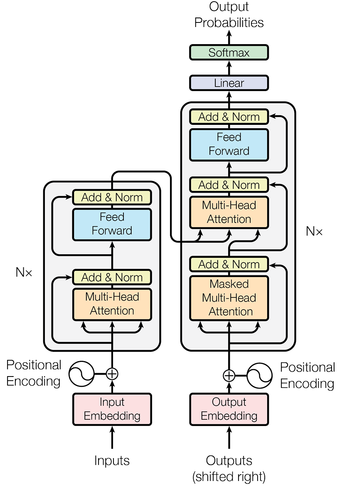

# Transformer实现

## Transformer架构



```python
class Transformer(nn.Module):
    def __init__(self, vocab_size, num_layers, d_model, num_heads, d_ff, max_len, dropout=0.1):
        super(Transformer, self).__init__()
        self.d_model = d_model
        self.encoder = Encoder(num_layers, d_model, num_heads, d_ff, dropout)
        self.decoder = Decoder(num_layers, d_model, num_heads, d_ff, dropout)
        self.position_encoding = PositionalEncoding(d_model, max_len, dropout)
        self.embedding = nn.Embedding(vocab_size, d_model, padding_idx=0)
        self.final_linear = nn.Linear(d_model, vocab_size)

    def generate_mask(self, src, tgt):
        # 1. src_mask: 用于编码器的掩码，屏蔽掉 padding token
        src_mask = (src != 0).unsqueeze(1).unsqueeze(2)  # (batch_size, 1, 1, src_len)

        # 2. tgt_mask: 用于解码器的掩码，屏蔽掉 padding token 和未来的 token
        tgt_pad_mask = (tgt != 0).unsqueeze(1).unsqueeze(2)  # (batch_size, 1, 1, tgt_len)
        tgt_len = tgt.size(1)
        tgt_sub_mask = torch.tril(torch.ones((tgt_len, tgt_len), device=src.device)).bool()      # (tgt_len, tgt_len)
        # 将 padding 掩码和下三角掩码结合起来
        tgt_mask = tgt_pad_mask & tgt_sub_mask
        return src_mask, tgt_mask

    def forward(self, src, tgt):
        src_mask, tgt_mask = self.generate_mask(src, tgt)
        src_emb = self.embedding(src) * math.sqrt(self.d_model)
        tgt_emb = self.embedding(tgt) * math.sqrt(self.d_model)
        src_emb = self.position_encoding(src_emb)
        tgt_emb = self.position_encoding(tgt_emb)

        # 编码输入
        encoder_output = self.encoder(src_emb, src_mask)
        # 解码输出，从输入中抽取
        decoder_output = self.decoder(tgt_emb, encoder_output, src_mask, tgt_mask)
        # 将解码器输出映射到词汇表大小的维度
        output = self.final_linear(decoder_output)
        return output
```

## Multi-Head Attention

MHA（Multi-Head Attention，多头注意力）会将注意力计算分成多个头，每个头可以学习不同的信息关系。

```python
class MultiHeadAttention(nn.Module):
    def __init__(self, d_model, num_heads):
        super(MultiHeadAttention, self).__init__()
        if d_model % num_heads != 0:
            raise ValueError("d_model 必须能被 num_heads 整除")
        self.d_model = d_model
        self.num_heads = num_heads
        self.d_k = d_model // num_heads
        # 定义 Q, K, V 和输出的线性变换层
        self.W_q = nn.Linear(self.d_model, self.d_model)
        self.W_k = nn.Linear(self.d_model, self.d_model)
        self.W_v = nn.Linear(self.d_model, self.d_model)
        self.W_o = nn.Linear(self.d_model, self.d_model)

    def forward(self, Q, K, V, mask=None):
        batch_size = Q.size(0)
        # 拆分维度 (batch_size, seq_len, d_model) -> (batch_size, num_heads, seq_len, d_k)
        Q = self.W_q(Q).view(batch_size, -1, self.num_heads, self.d_k).transpose(1, 2)
        K = self.W_k(K).view(batch_size, -1, self.num_heads, self.d_k).transpose(1, 2)
        V = self.W_v(V).view(batch_size, -1, self.num_heads, self.d_k).transpose(1, 2)

        # 计算注意力分数 (batch_size, num_heads, seq_len, seq_len)
        attn_score = torch.matmul(Q, K.transpose(-2, -1)) / math.sqrt(self.d_k)
        # 应用掩码
        if mask is not None:
            attn_score = attn_score.masked_fill(mask==0, -1e9)
        # 计算注意力权重
        attn_score = torch.softmax(attn_score, dim=-1)
        # 按照注意力权重加权求和 (batch_size, num_heads, seq_len, d_k)
        output = torch.matmul(attn_score, V)

        # 合并多头输出 (batch_size, num_heads, seq_len, d_k) -> (batch_size, seq_len, d_model)
        output = output.transpose(1, 2).contiguous().view(batch_size, -1, self.d_model)
        output = self.W_o(output)
        return output
```

## Multi-Query Attention

为了减少 Key 和 Value 的存储与读取开销，降低 KV Cache 占用，对多头注意力做了许多改进

MQA（Multi-Query Attention，多查询注意力），每一层Transoformer中多个Query头共用一组K、V，模型的表达能力可能有所下降

```python
class MultiQueryAttention(nn.Module):
    def __init__(self, d_model, num_heads):
        super().__init__()
        self.d_k = d_model // num_heads
        self.d_model = d_model
        self.num_heads = num_heads
        self.W_q = nn.Linear(d_model, d_model)
        self.W_k = nn.Linear(d_model, self.d_k)
        self.W_v = nn.Linear(d_model, self.d_k)
        self.W_o = nn.Linear(d_model, d_model)

    def forward(self, Q, K, V, mask=None):
        batch_size = Q.shape[0]
        # 多个Query头共用一份K V
        # (batch_size, seq_len, d_model) -> (batch_size, num_heads, seq_len, d_k)
        Q = self.W_q(Q).view(batch_size, -1, self.num_heads, self.d_k).transpose(1, 2)
        K = self.W_k(K).view(batch_size, -1, 1, self.d_k).transpose(1, 2)
        V = self.W_v(V).view(batch_size, -1, 1, self.d_k).transpose(1, 2)

        attn = (Q @ K.transpose(-1, -2)) / math.sqrt(self.d_k)
        if mask is not None:
            attn = attn.masked_fill(mask == 0, -1e9)
        attn_score = torch.softmax(attn, dim=-1)

        # (batch_size, num_heads, seq_len, d_k) -> (batch_size, seq_len, d_model)
        output = attn_score @ V
        output = output.transpose(1, 2).contiguous().view(batch_size, -1, self.d_model)
        output = self.W_o(output)
        return output

```

## Grouped-Query Attention

GQA（Grouped-Query Attention，分组查询注意力），将Query头分为 $g$ 组 $(1 <= g <= h)$，每组内共享一份K、V，在模型能力和压缩效率之间做取舍。

* 当 $g = 1$ 时为 MQA，$g = h$ 时为 MHA

```python
class GroupedQueryAttention(nn.Module):
    def __init__(self, d_model, num_heads, num_groups):
        super().__init__()
        self.d_model = d_model
        self.num_heads = num_heads
        self.num_groups = num_groups
        self.d_k = d_model // num_heads

        self.W_q = nn.Linear(d_model, d_model)
        self.W_k = nn.Linear(d_model, self.d_k * num_groups)
        self.W_v = nn.Linear(d_model, self.d_k * num_groups)
        self.W_o = nn.Linear(d_model, d_model)

    def forward(self, Q, K, V, mask=None):
        batch_size = Q.shape[0]
        # (batch_size, seq_len, d_model) -> (batch_size, num_heads, seq_len, d_k)
        Q = self.W_q(Q).view(batch_size, -1, self.num_heads, self.d_k).transpose(1, 2)

        # (batch_size, seq_len, d_k * num_groups) -> (batch_size, num_groups, seq_len, d_k)
        K = self.W_k(K).view(batch_size, -1, self.num_groups, self.d_k).transpose(1, 2)
        # (batch_size, num_groups, seq_len, d_k) -> (batch_size, num_groups, num_heads/num_groups, seq_len, d_k)
        # (batch_size, num_groups, num_heads / num_groups, seq_len, d_k) ->(batch_size, num_heads, seq_len, d_k)
        K = (K[:, :, None, :, :].expand(batch_size, self.num_groups, self.num_heads // self.num_groups, -1, self.d_k)
             .reshape(batch_size, self.num_heads, -1, self.d_k))

        V = self.W_v(V).view(batch_size, -1, self.num_groups, self.d_k).transpose(1, 2)
        V = (V[:, :, None, :, :].expand(batch_size, self.num_groups, self.num_heads // self.num_groups, -1, self.d_k)
             .reshape(batch_size, self.num_heads, -1, self.d_k))

        attn = (Q @ K.transpose(-1, -2)) / math.sqrt(self.d_k)
        if mask is not None:
            attn = attn.masked_fill(mask==0, -1e9)
        attn_score = torch.softmax(attn, dim=-1)

        # (batch_size, num_heads, seq_len, d_k) -> (batch_size, seq_len, d_model)
        output = (attn_score @ V).transpose(1, 2).contiguous().view(batch_size, -1, self.d_model)

        return self.W_o(output)
```

## Encoder

```python
class EncoderLayer(nn.Module):
    def __init__(self, d_model, num_heads, d_ff, dropout=0.1):
        super(EncoderLayer, self).__init__()
        self.mha = MultiHeadAttention(d_model, num_heads)
        self.ffn = nn.Sequential(
            nn.Linear(d_model, d_ff),
            nn.ReLU(),
            nn.Linear(d_ff, d_model)
        )
        self.layernorm1 = nn.LayerNorm(d_model)
        self.layernorm2 = nn.LayerNorm(d_model)
        self.dropout = nn.Dropout(dropout)

    def forward(self, x, mask=None):
        attn_output = self.mha(x, x, x, mask)
        x = self.layernorm1(x + self.dropout(attn_output))

        ffn_output = self.ffn(x)
        x = self.layernorm2(x + self.dropout(ffn_output))
        return x

class Encoder(nn.Module):
    def __init__(self, num_layers, d_model, num_heads, d_ff, dropout=0.1):
        super(Encoder, self).__init__()
        self.layers = nn.ModuleList([EncoderLayer(d_model, num_heads, d_ff, dropout) for _ in range(num_layers)])

    def forward(self, x, mask=None):
        for layer in self.layers:
            x = layer(x, mask)
        return x
```

## Decoder

```python
class DecoderLayer(nn.Module):
    def __init__(self, d_model, num_heads, d_ff, dropout=0.1):
        super(DecoderLayer, self).__init__()
        self.self_attn = MultiHeadAttention(d_model, num_heads)
        self.layernorm1 = nn.LayerNorm(d_model)

        self.cross_attn = MultiHeadAttention(d_model, num_heads)
        self.layernorm2 = nn.LayerNorm(d_model)

        self.ffn = nn.Sequential(
            nn.Linear(d_model, d_ff),
            nn.ReLU(),
            nn.Linear(d_ff, d_model)
        )
        self.layernorm3 = nn.LayerNorm(d_model)

        self.dropout = nn.Dropout(dropout)

    def forward(self, x, encoder_output, src_mask=None, tgt_mask=None):
        attn_output1 = self.self_attn(x, x, x, tgt_mask)
        x = self.layernorm1(x + self.dropout(attn_output1))

        attn_output2 = self.cross_attn(x, encoder_output, encoder_output, src_mask)
        x = self.layernorm2(x + self.dropout(attn_output2))

        ffn_output = self.ffn(x)
        x = self.layernorm3(x + self.dropout(ffn_output))

        return x

class Decoder(nn.Module):
    def __init__(self, num_layers, d_model, num_heads, d_ff, dropout=0.1):
        super(Decoder, self).__init__()
        self.layers = nn.ModuleList([DecoderLayer(d_model, num_heads, d_ff, dropout) for _ in range(num_layers)])

    def forward(self, x, encoder_output, src_mask=None, tgt_mask=None):
        for layer in self.layers:
            x = layer(x, encoder_output, src_mask, tgt_mask)
        return x
```

## PositionalEncoding

$$
 PE_{(pos,2i)} = \sin\left( \frac{pos}{10000^{2i/d_{\text{model}}}} \right), \\ 
 PE_{(pos,2i+1)} = \cos\left( \frac{pos}{10000^{2i/d_{\text{model}}}} \right) 
$$

- $pos$：$token$ 在序列中的位置（下标，从 0 开始）
- $d_{\text{model}}$：词嵌入向量的维度大小
- $i$：维度索引，$i=0,1,2,\dots,\frac{d_{\text{model}}}{2}-1$
  - $2i$：嵌入向量**偶数维度**，使用 $sin$
  - $2i+1$：嵌入向量**奇数维度**，使用 $\cos$

```python
class PositionalEncoding(nn.Module):
    def __init__(self, d_model, max_len=5000, dropout=0.1):
        super(PositionalEncoding, self).__init__()
        position = torch.arange(0, max_len, dtype=torch.float).unsqueeze(1)
        div_term = torch.exp(torch.arange(0, d_model, 2) * (-math.log(10000) / d_model))

        pe = torch.zeros((max_len, d_model))
        # 偶数维度使用 sin, 奇数维度使用 cos
        pe[:, 0::2] = torch.sin(position * div_term)
        pe[:, 1::2] = torch.cos(position * div_term)
        # 将 pe 注册为 buffer，这样它就不会被视为模型参数，但会随模型移动（例如 to(device)）
        self.register_buffer('pe', pe)

        self.dropout = nn.Dropout(dropout)

    def forward(self, x):
        x = x + self.pe[:x.size(1), :].unsqueeze(0)
        return self.dropout(x)
```

## 面试题

### 0.Transformer与RNN对比

Transformer与RNN是两种序列seq到序列seq的的架构模型，RNN 通过循环状态逐步处理序列，Transformer 通过注意力机制直接建模序列中不同位置之间的关系。

RNN：对于序列中第t个 token，其隐藏状态 $h_t$由当前输入$x_t$和上一时刻隐藏状态$h_{t-1}$共同计算： $h_t = \sigma(W_h h_{t-1} + W_x x_t + b)$ ，信息沿时间步有序单向传递

Transformer：将输入映射为查询（Q）、键（K）、值（V）三个向量，通过 Q 与 K 点乘计算相似度权重，对 V 加权求和得到融合全局上下文的表征，采用**多头注意力**在多个特征子空间捕捉不同类型的语义依赖，配合残差连接与层归一化，支持深层堆叠。无时间依赖和位置信息，必须引入位置编码，支持并行计算和矩阵计算优化

|                | Transformer                                | RNN                                     |
| -------------- | ------------------------------------------ | --------------------------------------- |
| 并行计算能力   | 编码器解码器在训练可并行，矩阵运算容易优化 | 训练无法并行，必须按时间步逐个计算      |
| 长距离捕捉能力 | 直接建模不同位置信息                       | 序列越长，信息衰减越严重                |
| 梯度传播       | 配合残差连接与层归一化，支持深层堆叠       | 每次要乘以梯度矩阵，会导致梯度消失/爆炸 |

### 1.Transformer为何使用多头注意力机制？（为什么不使用一个头）

单头注意力只能在一个空间内学习注意力关系，模型的表达能力受限，无法充分学习多种关系

多头注意力允许模型并行的在不同子空间学习不同的匹配模式，比如一个头关注语法，另一个头关注语义，允许模型组合多种匹配模式，形成更复杂的表达，过多的头可能存在冗余

### 2.Transformer为什么Q和K使用不同的权重矩阵生成，为何不能使用同一个值进行自身的点乘？ （注意和第一个问题的区别）

使用不同的 Q、K 投影是为了增加匹配函数的灵活性， Query 和 Key 使用不同的权重矩阵可以学习不同的投影方式，W_q学习当前位置想要寻找什么信息。W_k学习当前通过什么特征可以与其他位置匹配。W_v学习提供加权内容。QKV在不同的空间表达有助于模型捕捉不同的依赖关系，增加模型的表达能力

如果使用同一套权重，注意力分数来自同一套投影，无法独立学习查询空间和键空间。

### 3.Transformer计算attention的时候为何选择点乘而不是加法？两者计算复杂度和效果上有什么区别？

点乘注意力与加法注意力理论复杂度都是 $O(n^2d_k)$，但点乘能够转化为矩阵乘法，可以充分利用 GPU 高度优化的矩阵运算，实际速度更快、显存开销更小。

> 论文原话：While the two are similar in theoretical complexity, dot-product attention is much faster and more space-efficient in practice, since it can be implemented using highly optimized matrix multiplication code

### 4.为什么在进行softmax之前需要对attention进行scaled（为什么除以dk的平方根），并使用公式推导进行讲解

1. 设 $q,k$ 都是**独立同分布、均值为 0，方差为 1**的 $d_k$ 维向量，点乘 s 的期望与方差分别为 0 和 $\text{Var}(s)=\text{Var}\left(\sum_{i=1}^{d_k} q_i k_i\right)=\sum_{i=1}^{d_k}\text{Var}(q_i k_i) = d_k$ ，维度越高，内积数值震荡越大。
2. 除以 $\sqrt{d_k}$，将内积方差归一化为 1，稳定 softmax 输入分布，防止梯度消失，保证梯度有效。

### 5.在计算attention score的时候如何对padding做mask操作？

在计算注意力分数后，Softmax前，对padding位置，将注意力分数设置为$-inf$，Softmax 后的注意力权重就是 0

### 6.为什么在进行多头注意力的时候需要对每个head进行降维？（可以参考上面一个问题）

1. 控制计算成本。 如果每个头都使用 512 维，那么 8 个头的总内部维度将达到 4096，计算和存储开销显著增加。

2. 让不同头学习不同的特征子空间。 每个头可以在自己的投影空间里进行匹配。

3. 保持模型总体维度。 拼接后仍然是 512 维，便于通过输出投影 $W^O$ 与残差连接融合。

### 7.大概讲一下Transformer的Encoder模块？

经典 Transformer Encoder 由多个相同结构的 Encoder Layer 堆叠而成。每一层有两个主要子层：

1. Multi-Head Self-Attention。
2. Position-wise Feed-Forward Network（FFN）。

略

### 8.为何在获取输入词向量之后需要对矩阵乘以embedding size的开方？意义是什么？

Transformer 的 Embedding 使用 Xavier 初始化后元素方差为$1/d_{model}$，数值偏小。乘以\(\sqrt{d_{model}}\)，将 embedding 元素方差恢复为 1，和正弦位置编码 PE 的量级保持一致，同时保证送入自注意力的 Q、K 向量数值尺度合适，避免点积过大造成 softmax 饱和、梯度消失。

### 9.简单介绍一下Transformer的位置编码？有什么意义和优缺点？

Self-Attention 本身并不天然知道 token 的先后顺序。

如果只使用内容向量做 Self-Attention，模型缺少显式的位置信息。在输入中加入位置编码。

经典论文采用正弦和余弦位置编码，不同维度使用不同频率：低频分量变化缓慢，高频分量变化较快，组合起来表示位置

### 10.你还了解哪些关于位置编码的技术，各自的优缺点是什么？

* 可学习的绝对位置编码（Learned Absolute PE）

为每个位置分配一个可训练向量，与 Token Embedding 相加。

优点：灵活，模型可以直接学习位置表示。

缺点：最大位置长度通常受训练参数表限制，长距离外推能力不一定好。

* 相对位置编码（Relative PE）

重点描述两个 token 之间的相对距离，而不只描述各自的绝对位置。

优点：更直接地建模相对距离，对平移后的相同局部关系可能更自然。

缺点：实现更复杂

* ALiBi（Attention with Linear Biases）

直接在注意力分数上加入与距离相关的偏置，通常对距离越远的 Key 施加越大的负偏置。

优点：不需要为每个位置增加一张可学习的绝对位置嵌入表，长序列外推设计简单。

缺点：线性距离偏置表达形式较受限制，长距离行为依赖模型训练情况。

* RoPE（Rotary Position Embedding）

对 Query 和 Key 的二维特征分组施加随位置变化的旋转：$q_m'=R_mq_m, k_n'=R_nk_n$，因而点积与相对位置 \(m-n\) 有关。

优点：自然地把位置信息融入 Q、K 的交互；已被大量现代 LLM 使用。

缺点：长上下文外推仍然可能退化，实际应用常需要调整频率或使用位置插值等方法。

### 11.简单讲一下Transformer中的残差结构以及意义。

1. 保留原始信息。 子层可以在输入基础上学习需要增加或改变的内容。

2. 改善梯度传播。 反向传播时存在直接经过恒等分支的梯度路径，有助于深层网络优化。

3. 使子层学习增量。 当 $F(x)$ 较小时，输出仍然保留大部分输入。

### 12.为什么transformer块使用LayerNorm而不是BatchNorm？LayerNorm 在Transformer的位置是哪里？

* BatchNorm：主要沿着 Batch 维度统计特征的均值与方差。

* LayerNorm：对每个样本、每个 token 的隐藏特征维度进行归一化，不依赖batch_size和seq_len

Post-LN：先做子层运算和残差相加，再归一化。Pre-LN：先归一化子层输入，再进行运算并加上残差。

### 13.简答讲一下BatchNorm技术，以及它的优缺点。

BatchNorm（批量归一化）在一个 Batch 中统计各个特征的均值和方差，然后对特征进行标准化，并通过可学习参数进行缩放和平移。

优点：可以改善数值尺度，降低模型对权重初始化的敏感度，缓解梯度消失与梯度爆炸。

缺点：

* 对 Batch Size 比较敏感，小 Batch 的统计量可能不稳定。

* 训练与推理行为不一致：训练用批次统计量，推理用全局移动平均统计量，存在分布差异

### 14.简单描述一下Transformer中的前馈神经网络？使用了什么激活函数？

FFN是每个编码器和解码器都具备的结构，位于多头注意力模块后，由两层全连接构成，对每个token进行独立特征变换，先进行升维，在更丰富的特征空间中进行非线性变换，最后再降回原维度，增加模型的非线性表达能力

经典 Transformer 使用 ReLU，但现代模型也经常采用 GELU、SwiGLU 等激活结构

### 15.Encoder端和Decoder端是如何进行交互的？（在这里可以问一下关于seq2seq的attention知识）

1. Encoder 处理完整的输入序列，输出全序列的上下文，每个位置都融合了其他位置的信息，作为交叉注意力的 Key 和 Value；
2. Decoder 每层除了自注意力，还包含一层交叉注意力：Query 来自 Decoder 自注意力的输出（当前已生成 token 的表征），Key 和 Value 全部来自 Encoder 的最终输出；
3. Decoder 生成每个 token 时，都通过交叉注意力动态关注输入序列的不同位置，从输入中抽取相关的信息，实现输入到输出的映射。

### 16.Decoder阶段的多头自注意力和encoder的多头自注意力有什么区别？（为什么需要decoder自注意力需要进行 sequence mask)

Encoder 自注意力是双向的，仅需 padding mask 屏蔽填充的无效 token，每个 token 可以看见序列中所有其他 token；Decoder 自注意力是单向因果的，除了 padding mask，必须额外加 sequence mask（因果掩码），每个位置只能看到自身及之前的 token，无法看到后续位置

### 17.Transformer的并行化提现在哪个地方？Decoder端可以做并行化吗？

1. **Encoder 端完全并行**：自注意力的 Q/K/V 计算、注意力权重计算，以及 FFN 的逐位置运算，都可以对全序列一次性并行完成
2. **训练阶段 可并行**：训练时拥有完整的目标序列真值，通过 sequence mask 屏蔽未来信息后，整个目标序列的自注意力、FFN 都可以一次性并行计算，大幅提升训练效率。

- 推理阶段 Decoder 无法完全并行：自回归生成模式下，第 t 个 token 的生成必须依赖前 t-1 个 token 的结果，本质是串行过程。

### 19.Transformer训练的时候学习率是如何设定的？Dropout是如何设定的，位置在哪里？Dropout 在测试的需要有什么需要注意的吗？

原版 Transformer 采用**带预热（Warmup）的学习率策略**

- 预热阶段（前 warmup_steps 步，默认 4000 步）：学习率线性上升，避免初期参数不稳定、梯度过大破坏模型
- 衰减阶段：学习率随训练步数的平方根反比下降，逐步收敛。 

Dropout 设定与位置：原版 Transformer dropout 概率默认设为 0.1，主要分布在三处：

1. 嵌入层之后：词嵌入与位置编码相加后施加 dropout；
2. 每个子层输出后：多头注意力、FFN 的输出
3. 注意力权重上：计算完注意力分数后，对权重矩阵做 dropout，随机丢弃部分注意力连接。

* 测试 / 推理必须关闭 dropout，模型切换为 eval 模式，所有神经元都参与计算，保证输出稳定，确保同输入输出一致。

### 20.解码端的残差结构有没有把后续未被看见的mask信息添加进来，造成信息的泄露。

不会，残差连接加的是当前位置的输入，而不是未来位置的输入

Mask 控制的是 Attention 中信息可以从哪里流向哪里；残差连接只是将同一位置的原始输入加回子层输出。只要输入位置和输出位置不包含未来目标信息，残差连接不会导致信息泄露。
